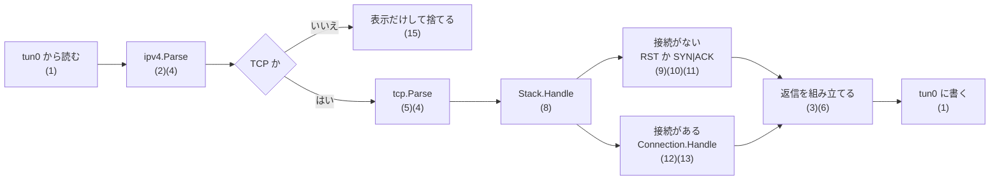

# 設計

いまのコードの構成と、設計の決まりごとを書く。これから変える予定のところは、最後の節にまとめる。

## 範囲

- ひとまずの目標は、自作の型が `net.Listener` と `net.Conn` を満たし、`net/http` のサーバがその上で動くこと。何を含めて何を含めないかは [roadmap.md](roadmap.md) の「ひとまずの目標」に書いてある
- TUN デバイス（L3）から生の IPv4 パケットを読み書きする。Ethernet と ARP は扱わない
- 通信の相手は同じマシンの Linux カーネル。`tun0` に `10.10.0.1 peer 10.10.0.2` を割り当て、カーネルが `10.10.0.1`、自作スタックが `10.10.0.2` になる
- TCP は [RFC 9293](https://datatracker.ietf.org/doc/html/rfc9293) に従う。IPv4 はヘッダのパースと組み立てだけで、フラグメントと IP オプションは扱わない

## パケットの流れ

箱の中の番号は、下の「機能と実装の対応」の行に当たる。

`Stack.Handle` から先の分岐は、[internal/stack/README.md](../internal/stack/README.md) に図と表がある。

`cmd/tuntcp/main.go` が上の順に呼ぶ。読み取りは別の goroutine（`readLoop`）で行い、チャネルでメインのループに渡す。`Stack` に触るのはメインの goroutine だけなので、ロックは持たない。

## 機能と実装の対応

一番上の粒度の対応表。受信したパケットが通る順に並べてある。1 行が 1 つの機能で、仕様、コードの入口、それを確かめるテストを結ぶ。これより細かい対応（状態と入力ごとの分岐）は、[internal/stack/README.md](../internal/stack/README.md) に書いてある。

状態の意味: **済** は実装とテストがある。**一部** は仕様の一部だけ実装している。**省略** は仕様にあるが意図してやっていない。**未** はこれから実装する。

| # | 機能 | 仕様 | コードの入口 | テスト | 状態 |
|---|---|---|---|---|---|
| 1 | TUN デバイスを作り、IP パケットを読み書きする | Linux の TUN/TAP（カーネルの文書 `tuntap`） | `tun.Create`、`cmd/tuntcp` の `readLoop` | 単体テストなし。`task e2e` でパケットが流れることを見る | 済 |
| 2 | IPv4 ヘッダを読み、長さとチェックサムを検査する | RFC 791 3.1 | `ipv4.Parse` | `TestParseIPv4Header*`、`TestVerifyIPv4Checksum` | 済。フラグメントと IP オプションの解釈は省略 |
| 3 | IPv4 ヘッダを組み立てる | RFC 791 3.1 | `ipv4.Header.Serialize` | `TestHeader_Serialize*`、`TestHeader_RoundTrip` | 済 |
| 4 | インターネットチェックサムを計算する | RFC 1071 | `checksum.Sum`、`checksum.Fold` | `TestSum`、`TestFold` | 済 |
| 5 | TCP ヘッダを読み、疑似ヘッダ込みのチェックサムを検査する | RFC 9293 3.1 | `tcp.Parse` | `TestParseTCPHeader*`、`TestVerifyTCPChecksum` | 済。オプションは切り出すだけで解釈しない（M11） |
| 6 | TCP ヘッダを組み立てる | RFC 9293 3.1 | `tcp.Header.Serialize` | `TestSerializeTCPHeader*` | 済。オプションは付けない（M11） |
| 7 | シーケンス番号を modulo 2^32 で比べる | RFC 9293 3.4 | `tcp.SeqLT`、`tcp.SeqLE` | `TestSeqCompare` | 済 |
| 8 | 受信セグメントを 4-tuple で接続に振り分ける | RFC 9293 3.3.1（TCB）、3.10.7 | `Stack.Handle` | `TestHandle_MultipleConnections`（T4-7 まで失敗） | 済 |
| 9 | 接続のないセグメントに RST を返す | RFC 9293 3.10.7.1 | `buildRST` | `TestBuildRST*`、`TestHandle_ClosedPort` | 済 |
| 10 | LISTEN 中のポートで SYN を受け、SYN\|ACK を返して SYN-RECEIVED にする | RFC 9293 3.10.7.2 | `Stack.Handle` | `TestHandle_Listen*`、`task e2e` の検証 | 済。セキュリティの検査は省略 |
| 11 | 初期シーケンス番号（ISS）を選ぶ | RFC 9293 3.4.1 | `Stack.ISS`、`randomISS` | なし | 一部。下の「仕様と合っていないもの」を参照 |
| 12 | 接続のあるセグメントを、First〜Eighth の順に処理する | RFC 9293 3.10.7.4 | `Connection.Handle`、`tcp.SegmentAcceptable` | `TestHandle_SynReceived_*`、`TestHandle_Established_*`、`TestSegmentAcceptable` | 一部。下の表を参照 |
| 13 | LISTEN か CLOSED に戻った接続をテーブルから消す | RFC 9293 3.10.7.4（TCB の削除） | `Stack.Handle` | `TestHandle_SynReceived_NewSYNInWindow_ReturnsToListen` | 済 |
| 14 | データの送受信、切断、Socket API、再送、フロー制御、MSS | [roadmap.md](roadmap.md) の M6〜M11 | — | — | 未 |
| 15 | 受信と送信のパケットを画面に表示する | 仕様なし | `cmd/tuntcp` の `display*` | なし | 済 |
| 16 | 実機で動かし、記録を検証する | [roadmap.md](roadmap.md) の M0 | `scripts/e2e.sh`、`scripts/e2e-check.sh` | 記録を差し替えて、落ちるべきときに落ちることを確かめた | 済 |

12 の内訳。RFC 9293 3.10.7.4 の 8 つの段階ごとの状態。

| 段階 | 内容 | 状態 |
|---|---|---|
| First | シーケンス番号の検査 | 済。RCV.WND が 0 のときの例外と、はみ出た部分の切り落としは未 |
| Second | RST | 未（T4-4） |
| Third | セキュリティ | 省略 |
| Fourth | SYN | 一部。SYN-RECEIVED で LISTEN に戻る処理だけ。同期済みの状態での扱い（RFC 5961 の challenge ACK）は目標のあと |
| Fifth | ACK | 一部。SYN-RECEIVED から ESTABLISHED への遷移だけ。ACK の範囲の検査は未（T4-6）、ESTABLISHED での処理は未（T6-6） |
| Sixth | URG | 未。扱いを決めていない |
| Seventh | データ | 未（T4-7、T6-2） |
| Eighth | FIN | 未（T7-3） |

### 仕様と合っていないもの

- **ISS の選び方**: RFC 9293 3.4.1 は、時計に基づいて選ぶこと（MUST-8）と、`ISN = M + F(4-tuple, 秘密の鍵)` の形にすること（SHLD-1）を求めている。いまの `randomISS` は、毎回ただの乱数を返す。意図して外したのか、直すのかを決めていない

### 仕様と文書から説明できないもの

減らしていく対象。直すか、理由を書くかのどちらかにする。

- `defaultWndSize = 65535`: なぜこの値かが、どこにも書いていない。受信バッファと結びついていない（M10 で直る）
- `buildSegment` の `TotalLen: 40`: ペイロードがない前提の固定値（T6-1 で直る）
- `Stack.Handle` の `// TODO: セキュリティ情報が...`: 省略と決めたのか、未実装なのかが書いていない
- `cmd/tuntcp` が、送る前の返信をもう一度パースしている: 表示のためだけの処理で、TCP のパースのエラーを捨てている
- どのテストも通らない行: `randomISS` の中身（テストは `Stack.ISS` を差し替えるため）

## パッケージ

| パッケージ | 役割 |
|---|---|
| `internal/tun` | `/dev/net/tun` を開き、ioctl で TUN デバイスを作る |
| `internal/checksum` | インターネットチェックサム（`Sum` / `Fold`） |
| `internal/ipv4` | IPv4 ヘッダの `Parse` / `Serialize` とチェックサムの検証 |
| `internal/tcp` | TCP ヘッダの `Parse` / `Serialize`、フラグ、シーケンス番号の比較、状態（`State`）、TCB（`ControlBlock`） |
| `internal/stack` | 接続の管理と、受信セグメントの処理。分岐ごとの図と表は [README](../internal/stack/README.md) |
| `cmd/tuntcp` | エントリポイント。TUN を開き、80 番を LISTEN し、パケットを表示しながら `Stack` に渡す |

## internal/stack

- `Stack` は LISTEN 中のポート（`listeners`）と、接続のテーブル（`conns`）を持つ
- 接続は 4-tuple（`connKey`: 自分と相手の `netip.AddrPort`）で引く
- `Stack.Handle(ip, tcp, payload)` が受信セグメント 1 つを処理し、返信の IP パケットを返す。返すものがなければ `nil`
  - テーブルに接続があれば `Connection.Handle` に渡す。処理のあと LISTEN か CLOSED に戻った接続は、テーブルから消す
  - 接続がなく、ポートが LISTEN 中なら RFC 9293 3.10.7.2 に従う。SYN なら `Connection` を作って SYN-RECEIVED にし、SYN|ACK を返す
  - どちらでもなければ RFC 9293 3.10.7.1 に従って RST を返す（`buildRST`）
- `Connection` は `tcp.ControlBlock`（状態と、SND / RCV のシーケンス変数）を埋め込む
- `Connection.Handle` は RFC 9293 3.10.7.4 の First〜Eighth の順に並べる。いま中身があるのは Fourth（SYN）と Fifth（ACK）の一部だけ

## 決まりごと

- **プロトコル処理は I/O から切り離す。** `Stack` はパース済みのヘッダを受け取り、バイト列を返すだけにする。TUN、時刻、乱数には直接触らず、外から注入する（いまは `Stack.ISS`）。こうしておくと、テストは実デバイスも root 権限もなしで動く
- **テストは入口から書く。** `Stack.Handle` にセグメントを流し、返信と TCB を見る。内部関数の名前に依存させない
- **シーケンス番号は modulo 2^32 で比べる。** `tcp.SeqLT` / `tcp.SeqLE` を使う
- **RFC の節をコメントに書く。** 差分を RFC と突き合わせて読めるようにする
- **標準ライブラリだけで書く。** 例外は、テストで使う `golang.org/x/net/nettest` だけ

## いまの制限

- `buildSegment` の IPv4 `TotalLen` が 40 固定で、ペイロードを載せられない
- 送信するセグメントに TCP オプションを付けない（`DataOffset` は 5 固定）。受信したオプションは読み捨てる
- `Handle` の戻り値が返信 1 つだけなので、受信をきっかけにしない送信（データの送信、再送）ができない
- 状態は CLOSED、LISTEN、SYN-SENT、SYN-RECEIVED、ESTABLISHED の 5 つだけ

## これから変えるところ

マイルストーンが進むと、いまの「受信 1 つに返信 1 つ」の形では足りなくなる。次の順に広げる。

1. **送信キュー（M6）**: `Stack` が送りたいパケットをキューに積み、`main` がそれを TUN に書く。`Handle` の戻り値に頼らずに送れるようにする
2. **時計の注入（M7）**: タイマー（2MSL、再送、persist）のために、時刻を外から渡す。テストでは時間を手で進める
3. **イベントループ（M8）**: `Stack` を 1 つの goroutine が持ち、受信セグメント、タイマー、API の呼び出しをチャネルで受ける。`net.Listener` と `net.Conn` のメソッドは、このループに要求を送ってブロックする

接続は「入力（セグメント、タイマーの満了、API の呼び出し）を受けて、TCB を更新し、送るセグメントを出す」状態機械として保つ。この形は 3 つの変更を通して変えない。
