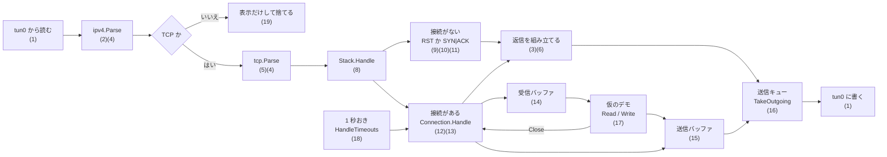

# 設計

いまのコードの構成と、設計の決まりごとを書く。これから変える予定のところは、最後の節にまとめる。

## 範囲

- ひとまずの目標は、自作の型が `net.Listener` と `net.Conn` を満たし、`net/http` のサーバがその上で動くこと。何を含めて何を含めないかは [roadmap.md](roadmap.md) の「ひとまずの目標」に書いてある
- TUN デバイス（L3）から生の IPv4 パケットを読み書きする。Ethernet と ARP は扱わない
- 通信の相手は同じマシンの Linux カーネル。`tun0` に `10.10.0.1 peer 10.10.0.2` を割り当て、カーネルが `10.10.0.1`、自作スタックが `10.10.0.2` になる
- TCP は [RFC 9293](https://datatracker.ietf.org/doc/html/rfc9293) に従う。IPv4 はヘッダのパースと組み立てだけで、フラグメントと IP オプションは扱わない

## パケットの流れ

箱の中の番号は、下の「機能と実装の対応」の行に当たる。

送るパケットの出口は送信キュー 1 つ。受信セグメントへの返信（ACK、RST、SYN|ACK）も、データも、`Stack` が送る順に積む。`main` は 1 つのセグメントを処理するたびに、キューを取り出して積まれた順に TUN に書く。

`Stack.Handle` から先の分岐は、[internal/stack/README.md](../internal/stack/README.md) に図と表がある。

`cmd/tuntcp/main.go` が上の順に呼ぶ。`Stack.Handle` のあと、仮のデモ（`demoServer`）が受信バッファを読み、HTTP リクエストの終わりが届いていれば決まったレスポンスを書いて閉じる。これとは別に、1 秒おきに `Stack.HandleTimeouts` を呼び、期限の来たタイマーを処理させる。読み取りは別の goroutine（`readLoop`）で行い、チャネルでメインのループに渡す。`Stack` に触るのはメインの goroutine だけなので、ロックは持たない。

## 機能と実装の対応

一番上の粒度の対応表。受信したパケットが通る順に並べてある。1 行が 1 つの機能で、仕様、コードの入口、それを確かめるテストを結ぶ。これより細かい対応（状態と入力ごとの分岐）は、[internal/stack/README.md](../internal/stack/README.md) に書いてある。

状態の意味: **済** は実装とテストがある。**一部** は仕様の一部だけ実装している。**省略** は仕様にあるが意図してやっていない。**未** はこれから実装する。

| # | 機能 | 仕様 | コードの入口 | テスト | 状態 |
|---|---|---|---|---|---|
| 1 | TUN デバイスを作り、IP パケットを読み書きする | Linux の TUN/TAP（カーネルの文書 `tuntap`） | `tun.Create`、`cmd/tuntcp` の `readLoop` | 単体テストなし。`task e2e` でパケットが流れることを見る | 済 |
| 2 | IPv4 ヘッダを読み、長さとチェックサムを検査する | RFC 791 3.1 | `ipv4.Parse` | `TestParseIPv4Header*`、`TestVerifyIPv4Checksum` | 済。フラグメントと IP オプションの解釈は省略 |
| 3 | IPv4 ヘッダを組み立てる | RFC 791 3.1 | `ipv4.Header.Serialize` | `TestHeader_Serialize*`、`TestHeader_RoundTrip` | 済 |
| 4 | インターネットチェックサムを計算する | RFC 1071 | `checksum.Sum`、`checksum.Fold` | `TestSum`、`TestFold` | 済 |
| 5 | TCP ヘッダを読み、疑似ヘッダ込みのチェックサムを検査する | RFC 9293 3.1 | `tcp.Parse` | `TestParseTCPHeader*`、`TestVerifyTCPChecksum` | 済。オプションは切り出すだけで解釈しない（M11） |
| 6 | TCP ヘッダを組み立てる | RFC 9293 3.1 | `tcp.Header.Serialize` | `TestSerializeTCPHeader*` | 済。オプションは付けない（M11） |
| 7 | シーケンス番号を modulo 2^32 で比べる | RFC 9293 3.4 | `tcp.SeqLT`、`tcp.SeqLE` | `TestSeqCompare` | 済 |
| 8 | 受信セグメントを 4-tuple で接続に振り分ける | RFC 9293 3.3.1（TCB）、3.10.7 | `Stack.Handle` | `TestHandle_MultipleConnections` | 済 |
| 9 | 接続のないセグメントに RST を返す | RFC 9293 3.10.7.1 | `buildRST` | `TestBuildRST*`、`TestHandle_ClosedPort` | 済 |
| 10 | LISTEN 中のポートで SYN を受け、SYN\|ACK を返して SYN-RECEIVED にする | RFC 9293 3.10.7.2 | `Stack.Handle` | `TestHandle_Listen*`、`task e2e` の検証 | 済。セキュリティの検査は省略 |
| 11 | 初期シーケンス番号（ISS）を選ぶ | RFC 9293 3.4.1 | `Stack.ISS`、`randomISS` | なし | 一部。下の「仕様と合っていないもの」を参照 |
| 12 | 接続のあるセグメントを、First〜Eighth の順に処理する | RFC 9293 3.10.7.4 | `Connection.Handle`、`tcp.SegmentAcceptable` | `TestHandle_*`（状態の名前ごと）、`TestSegmentAcceptable` | 一部。下の表を参照 |
| 13 | LISTEN か CLOSED になった接続をテーブルから消す | RFC 9293 3.10.7.4、3.10.5、3.10.8（TCB の削除） | `Stack.reap` | `TestHandle_SynReceived_NewSYNInWindow_ReturnsToListen`、`TestHandle_LastAck_ACK`、`TestAbort_SendsRST`、`TestTimeWait_ExpiresAfter2MSL` | 済 |
| 14 | 受け取ったデータを受信バッファに貯め、利用者が読み出す | RFC 9293 3.10.7.4 Seventh、3.10.3 | `Connection.Read`（仮の口） | `TestRead_*` | 一部。上限と広告ウィンドウとの結びつきは未（M10） |
| 15 | 利用者が書いたデータを送信バッファに積み、ウィンドウと MSS に収まる分を切り出して送る | RFC 9293 3.10.2、3.9.1.2（PSH）、3.7.1（MSS 536） | `Connection.Write`（仮の口）、`Connection.output` | `TestWrite_*`、`TestHandle_Established_ACK_SendsRemainingData` | 一部。再送（M9）、probe と Nagle（M10）、MSS の交換（M11）は未 |
| 16 | 送るパケットをすべて送信キューに積み、`main` が取り出して TUN に書く | 仕様なし（「対話で決めた仕様」） | `Stack.TakeOutgoing` | `TestHandle_Established_DataAndWindowOpen_QueuesACKThenData`、ほかのテストも `handle` と `takeSent` でキューから取り出す | 済 |
| 17 | HTTP リクエストに固定のレスポンスを返して閉じる仮のデモ | 仕様なし（M8 で捨てる） | `cmd/tuntcp` の `demoServer`、`Stack.Conn` | `task e2e` の検証（本文の一致、レスポンスへの ACK、切断） | 済 |
| 18 | 切断する。FIN を送って閉じ、相手の FIN を受け、TIME-WAIT を 2MSL で終える。RST を送って捨てる | RFC 9293 3.6、3.10.4、3.10.5、3.10.7.4 Eighth、3.10.8 | `Connection.Close`、`Connection.Abort`（どちらも仮の口）、`Stack.HandleTimeouts`、`Stack.Now` | `TestClose_*`、`TestAbort_*`、`TestTimeWait_*`、`task e2e` の検証（両方の向きの切断、`ss -tn` に残らない） | 済。`Abort` は実機で確かめていない。利用者への通知は未（T8-5） |
| 19 | 受信と送信のパケットを画面に表示する | 仕様なし | `cmd/tuntcp` の `display*` | なし | 済 |
| 20 | 実機で動かし、記録を検証する | [roadmap.md](roadmap.md) の M0 | `scripts/e2e.sh`、`scripts/e2e-check.sh` | 記録を差し替えて、落ちるべきときに落ちることを確かめた | 済 |
| 21 | Socket API、再送、フロー制御、MSS | [roadmap.md](roadmap.md) の M8〜M11 | — | — | 未 |

12 の内訳。RFC 9293 3.10.7.4 の 8 つの段階ごとの状態。

| 段階 | 内容 | 状態 |
|---|---|---|
| First | シーケンス番号の検査 | 済。RCV.WND が 0 のときの例外は未（M10）。はみ出た部分の切り落としは省略（「対話で決めた仕様」を参照） |
| Second | RST | 済。SYN-RECEIVED は LISTEN に、同期済みの状態は CLOSED にする。RFC 5961 の challenge ACK は目標のあと。利用者への通知は未（M8） |
| Third | セキュリティ | 省略 |
| Fourth | SYN | 一部。SYN-RECEIVED で LISTEN に戻る処理だけ。同期済みの状態での扱い（RFC 5961 の challenge ACK）は目標のあと |
| Fifth | ACK | 一部。SYN-RECEIVED での範囲の検査と ESTABLISHED への遷移、ESTABLISHED 以降での SND.UNA の更新と送信ウィンドウの更新、自分の FIN への ACK による遷移（FIN-WAIT-1 → FIN-WAIT-2、CLOSING → TIME-WAIT、LAST-ACK → CLOSED）。再送キューからの削除は未（M9） |
| Sixth | URG | 未。扱いを決めていない |
| Seventh | データ | 一部。ESTABLISHED、FIN-WAIT-1、FIN-WAIT-2 で、RCV.NXT から始まるデータを受信バッファに移して RCV.NXT を進め、ACK を返す。相手の FIN を受けたあとの状態では無視する。ACK を遅らせて送信データに相乗りさせることは未（扱いを決めていない） |
| Eighth | FIN | 済。FIN の番号が RCV.NXT と一致するときだけ処理する。利用者への通知は未（T8-5） |

### 仕様と合っていないもの

- **ISS の選び方**: RFC 9293 3.4.1 は、時計に基づいて選ぶこと（MUST-8）と、`ISN = M + F(4-tuple, 秘密の鍵)` の形にすること（SHLD-1）を求めている。いまの `randomISS` は、毎回ただの乱数を返す。意図して外したのか、直すのかを決めていない

### 仕様と文書から説明できないもの

減らしていく対象。直すか、理由を書くかのどちらかにする。

- `defaultWndSize = 65535`: なぜこの値かが、どこにも書いていない。受信バッファと結びついていない（M10 で直る）
- RST のウィンドウの欄: 接続のあるとき（`Connection.Handle`）は `c.Rcv.WND`、ないとき（`buildRST`）は `defaultWndSize` を入れている。RFC 9293 は RST のウィンドウの値を決めていない。揃っておらず、理由も書いていない
- `Stack.Handle` の `// TODO: セキュリティ情報が...`: 省略と決めたのか、未実装なのかが書いていない
- `cmd/tuntcp` が、送ったパケットをもう一度パースしている: 表示のためだけの処理（T6-7 で、パースのエラーを捨てずにログに出すようにした）
- どのテストも通らない行: `randomISS` の中身（テストは `Stack.ISS` を差し替えるため）、`Stack.Conn`（`main` のデモだけが使う。`task e2e` では通る）
- `main` が `HandleTimeouts` を呼ぶ間隔の 1 秒: 2MSL が 4 分なので足りる、という以上の根拠がない。`task e2e` は 4 分待たないので、この呼び出しが働くことは記録に残る形では確かめていない（T7-5 で、MSL を一時的に縮めて 1 回だけ手で確かめた）。M8 のイベントループで置き換える
- `Connection.Abort` は、どこからも呼ばれていない。単体テストだけが通る。M8 と T9-4 で使う

## パッケージ

| パッケージ | 役割 |
|---|---|
| `internal/tun` | `/dev/net/tun` を開き、ioctl で TUN デバイスを作る |
| `internal/checksum` | インターネットチェックサム（`Sum` / `Fold`） |
| `internal/ipv4` | IPv4 ヘッダの `Parse` / `Serialize` とチェックサムの検証 |
| `internal/tcp` | TCP ヘッダの `Parse` / `Serialize`、フラグ、シーケンス番号の比較、状態（`State`）、TCB（`ControlBlock`） |
| `internal/stack` | 接続の管理と、受信セグメントの処理。分岐ごとの図と表は [README](../internal/stack/README.md) |
| `cmd/tuntcp` | エントリポイント。TUN を開き、80 番を LISTEN し、パケットを表示しながら `Stack` に渡す。1 秒おきにタイマーを処理させる。HTTP に固定のレスポンスを返して閉じる仮のデモを持つ |

## internal/stack

- `Stack` は LISTEN 中のポート（`listeners`）と、接続のテーブル（`conns`）を持つ
- 接続は 4-tuple（`connKey`: 自分と相手の `netip.AddrPort`）で引く
- `Stack.Handle(ip, tcp, payload)` が受信セグメント 1 つを処理し、送る IP パケットを送信キューに積む。戻り値はない
  - テーブルに接続があれば `Connection.Handle` に渡す。処理のあと LISTEN か CLOSED になった接続は、テーブルから消す（`reap`）
  - 接続がなく、ポートが LISTEN 中なら RFC 9293 3.10.7.2 に従う。SYN なら `Connection` を作って SYN-RECEIVED にし、SYN|ACK を返す
  - どちらでもなければ RFC 9293 3.10.7.1 に従って RST を返す（`buildRST`）
- `Connection` は `tcp.ControlBlock`（状態と、SND / RCV のシーケンス変数）を埋め込み、受信バッファと送信バッファ（どちらも `bytes.Buffer`）を持つ
  - 受信バッファ: 受け取ったが読まれていないデータ。末尾が RCV.NXT の直前に当たる
  - 送信バッファ: 書かれたが ACK されていないデータ。先頭が SND.UNA に当たり、先頭から SND.NXT - SND.UNA バイトは送信済み
- `Connection.Handle` は RFC 9293 3.10.7.4 の First〜Eighth の順に並べる。段階ごとの状態は、上の「12 の内訳」の表にある。処理のあと、送れるようになったデータを送る（`output`）
- `Connection.Write` は送信バッファに積んで `output` を呼ぶ。`output` は SND.NXT から、相手のウィンドウ（SND.UNA + SND.WND の手前）と MSS 536 に収まる分を切り出し、送信キューに積む
- `Connection.Close` は状態を FIN-WAIT-1 か LAST-ACK に移して `output` を呼ぶ。`output` は、データを送り切ったあとに FIN を送る。`Connection.Abort` は RST を送って接続を消す
- `Stack.HandleTimeouts()` は、`Stack.Now()` の時刻と接続ごとのタイマー（`timer`）の期限を比べ、期限の来たものを処理する。いまあるのは TIME-WAIT の 2MSL だけ
- 接続は `Stack` へのポインタを持ち、送信キューに積むとき、時刻を得るとき、自分をテーブルから消すとき（`Abort`）に使う

## 決まりごと

- **プロトコル処理は I/O から切り離す。** `Stack` はパース済みのヘッダを受け取り、バイト列を返すだけにする。TUN、時刻、乱数には直接触らず、外から注入する（`Stack.ISS`、`Stack.Now`）。こうしておくと、テストは実デバイスも root 権限もなしで動く
- **テストは入口から書く。** `Stack.Handle` にセグメントを流し、送信キューに積まれたパケットと TCB を見る。内部関数の名前に依存させない
- **シーケンス番号は modulo 2^32 で比べる。** `tcp.SeqLT` / `tcp.SeqLE` を使う
- **RFC の節をコメントに書く。** 差分を RFC と突き合わせて読めるようにする
- **標準ライブラリだけで書く。** 例外は、テストで使う `golang.org/x/net/nettest` だけ

## 対話で決めた仕様

RFC が決めていない、または RFC の推奨から意図して外れた振る舞い。

- **切断と時計**（2026-11-13、M7。人間が「終わるまで自走してよい」としたので AI が決めた。**人間の確認待ち**）
  - RFC の解釈が入ったもの
    - **TIME-WAIT で相手の FIN の再送を受けたら、First で 2MSL を数え直す。** RFC 9293 3.10.7.4 は Fifth と Eighth の TIME-WAIT に「相手の FIN の再送に ACK を返し、2MSL を数え直す」と書いているが、再送された FIN は SEG.SEQ が RCV.NXT の手前なので、First の検査（Table 6）で受理できずに終わり、Fifth にも Eighth にも届かない。文面の順番どおりに実装すると、数え直しが起きない。意図を、届く場所（First）で実装した。再送と見なすのは、FIN の番号（SEG.SEQ + データ長）が RCV.NXT-1 のものだけ。捨てた案: 文面どおり数え直さない（こちらの ACK がまた落ちると、TIME-WAIT が明けたあとの再送に RST を返すことになる）。TIME-WAIT で受理できないセグメントなら何でも数え直す（古い重複で TIME-WAIT が延び続ける）
    - **FIN を処理するのは、FIN の番号（SEG.SEQ + データ長）が RCV.NXT と一致するときだけ。** 「RCV.NXT から始まらないデータはまるごと捨てる」（下の T4-7 の決めごと）の続き。捨てたデータに付いていた FIN や、手前が抜けた FIN は処理せず、いまの RCV.NXT を ACK で返す（MAY-13）。受信済みのデータの再送に新しい FIN が付いているときは、番号が一致するので FIN だけを処理する
    - **相手の FIN を受けたあとに、RCV.NXT から始まる FIN がまた来たら、文面どおり RCV.NXT を進めて ACK を返す。** 相手の誤りでしか起きない。Eighth の共通の手順をそのまま通すだけで、分岐を足していない。データは文面どおり無視し、返信もしない
    - **CLOSE-WAIT で Close を呼んだら、FIN を送る前でも LAST-ACK に入る。** 3.10.4 の文面は「データを送り切り、FIN を送ってから LAST-ACK に入る」と読める。ESTABLISHED の "In any case, enter FIN-WAIT-1 state" と揃えた。外に出るセグメントは変わらない。捨てた案: FIN を送るまで CLOSE-WAIT に留め、Close 済みかを別のフラグで持つ（Write を断るかが、状態だけでは決まらなくなる）。この結果、LAST-ACK と CLOSING でも、ESTABLISHED と同じ ACK の処理とデータの送信をする
    - **Abort で RST を送ったあと、TIME-WAIT に入らず CLOSED にする。** 3.5.2 は "The side of a connection issuing a reset should enter the TIME-WAIT state" と書き、3.10.5 は "Delete the TCB, enter CLOSED state" と書いていて、節どうしで食い違う。イベントごとの手順を書いた 3.10.5 に従った
  - RFC が決めていないもの
    - **FIN は、データとは別のセグメントで送る。** 最後のデータのセグメントに載せない。セグメントは 1 つ増えるが、データと FIN の両方がウィンドウと MSS に収まるかの分岐が要らない
    - **FIN にも、相手のウィンドウの空きを 1 つ求める。** FIN はシーケンス番号を 1 つ使い、ウィンドウの外のセグメントは相手の First の検査で受理されない。空きがなければ、ウィンドウが開くのを待つ。ウィンドウが 0 のまま開かないと FIN を送れない（データと同じ。ゼロウィンドウ probe は T10-2）
    - **時計は `Stack.Now func() time.Time` で注入し、タイマーは `Stack.HandleTimeouts()` が呼ばれたときに調べる。** `main` が 1 秒おきに呼ぶ。捨てた案: `Handle` や `HandleTimeouts` の引数で時刻を渡す（Close や Write もタイマーを動かすようになる M9 で、利用者の呼び出しごとに時刻を渡すことになる）。次の期限を `Stack` に聞いて、そこまで待つ（再送タイマーを入れる M9 か、M8 のイベントループで要る。2MSL だけなら 1 秒おきで足りる）
    - **MSL は 2 分**（RFC 9293 3.4.2 の値）。TIME-WAIT は 4 分。差し替える口は作っていない。Linux は TIME-WAIT を 60 秒にしている（確かめたのは `task e2e` の記録ではなく、一般に知られた値）
  - 仮の口
    - `Connection.Close() error` と `Connection.Abort() error`。どちらも M8 で `net.Conn` と `net.Listener` に置き換える
    - エラーは、RFC 9293 3.10 の文言の 2 つ（"connection does not exist"、"connection closing"）。形は T8-5 で決める
    - **SYN-RECEIVED での Close は実装しない。** エラーを返し、何も変えない。仕様は「送るデータがなければすぐ FIN を送って FIN-WAIT-1 に、あれば ESTABLISHED まで待つ」としている。M8 の `Accept` は ESTABLISHED の接続だけを返すので、利用者が SYN-RECEIVED の接続を閉じる場面がない
    - `Read` は変えていない。相手の FIN を受けたあとも、貯まっていなければ 0 を返すだけで、終わりを区別できない。`io.EOF` は T8-5。デモは `Connection.State` を見て、相手が先に閉じたことを知る
  - デモ（`demoServer`）: レスポンスを書いたら Close を呼ぶ。リクエストが揃う前に相手が閉じたとき（CLOSE-WAIT）も Close を呼ぶ。レスポンスに `Connection: close` を付ける（RFC 9112 9.6）
  - `task e2e`: `curl` に加えて、つないで何も送らずに閉じるクライアントを流す（ロードマップの T7-7 の文面より広い）。`curl` の最中の `ss -tn` の検査は外した

- **送る出口は送信キュー 1 つ**（2026-11-13、T7-0。人間が決めた）
  - `Stack` が送るパケットは、受信セグメントへの返信（ACK、RST、SYN|ACK）もデータも、すべて送信キューに積む。`Stack.Handle` は何も返さない。`main` は `Stack.TakeOutgoing` で取り出し、積まれた順に TUN に書く
  - 1 つのセグメントの処理で返信とデータの両方を送るときは、返信、データの順に積む
  - 捨てた案: 返信だけを `Stack.Handle` の戻り値で返し、データは送信キューから出す（T6-3 から T7-0 までの形）。送る順番を `main` が守ることになる。再送する SYN|ACK（T9-2）や Close で送る FIN（T7-4）は受信を起点にしないので、同じ種類のセグメントが 2 つの出口に分かれる。ACK をデータに相乗りさせることもできない

- **仮の読み書き口**（2026-11-11、T6-4、T6-7。人間が「自走してよい」としたので AI が決めた。**人間の確認待ち**）
  - 仮の口は 3 つ: `Connection.Read(p) int`（貯まっている分を移す。なければ待たずに 0）、`Connection.Write(p) error`（積んで送れる分を送る）、`Stack.Conn(local, remote)`（`main` が受信セグメントのアドレスから接続を引く）。どれも M8 で `net.Listener` / `net.Conn` に置き換える
  - `Write` は SYN-RECEIVED と ESTABLISHED で受け付ける（RFC 9293 3.10.2。SYN-RECEIVED では積むだけ）。それ以外ではエラーを返す。エラーの形は T8-5 で決める
  - 送るタイミング: `Write` の直後と、受信セグメントを処理した直後。Nagle などで待つことはしない（T10-3）
  - PSH: 送信バッファの未送信のデータを送り切るセグメントに立てる。SEND の PUSH フラグを実装しないときの RFC 9293 3.9.1.2 MUST-61 に従う
  - デモ（`demoServer`）: 受信したバイト列に空行（`\r\n\r\n`）が現れたら、`Content-Length` 付きの固定のレスポンスを 1 回書く。リクエストの中身は解釈しない。M8 で捨てる

- **RCV.NXT から始まらないデータは、ACK を返してまるごと捨てる**（2026-11-11、T4-7）
  - 対象は、First の検査では受理できるが SEG.SEQ が RCV.NXT と一致しないデータ。先に届いた後ろのデータ（間が抜けている）と、RCV.NXT をまたぐデータ（前半が受信済み）の 2 種類
  - RCV.NXT は進めず、`<SEQ=SND.NXT><ACK=RCV.NXT><CTL=ACK>` を返す。相手の再送に任せる
  - RFC 9293 3.10.7.4 から外れる点: 後ろのデータを取っておくこと（SHLD-31）と、またぐデータの新しい部分だけを処理すること（First の冒頭）をやらない。ACK を返すこと自体は MAY-13 が認めている
  - 理由: 取っておくには順序の入れ替わりを直すキューが要り、切り落としには境界の分岐が増える。どちらも通信が成り立つためには要らない
  - 捨てた案: またぐデータの受信済みの部分を切り落とし、新しい部分だけ受け取る
  - ウィンドウの右端を越えるデータの切り落としは、ここでは決めていない。ウィンドウが 65535 固定の間は起きないので、M10 で決める

## いまの制限

- 送信するセグメントに TCP オプションを付けない（`DataOffset` は 5 固定）。受信したオプションは読み捨てる
- 相手の FIN を受けたことを、利用者に伝える口がない。`Read` は 0 を返すだけ（T8-5）
- 再送しないので、FIN や、FIN への ACK が落ちると、切断が途中で止まる（M9）。FIN-WAIT-2 で相手の FIN を待つ時間にも上限がない
- TIME-WAIT の間（4 分）、同じアドレスとポートの組からの新しい SYN を受け付けない
- 送ったデータを再送しない。落ちたら接続が止まる（M9）
- 受信バッファと送信バッファに上限がなく、広告ウィンドウは 65535 のまま（M10）
- `Read` と `Write` は仮の口で、`Read` は待たずに 0 を返す。`main` の 1 つの goroutine からしか呼べない（M8）
- データを受けると ACK を返し、そのあとに送るデータは別のセグメントになる（ACK を相乗りさせない）

## これから変えるところ

マイルストーンが進むと、いまの「受信 1 つに返信 1 つ」の形では足りなくなる。次の順に広げる。

1. **送信キュー（M6 と T7-0、済）**: `Stack` が送りたいパケットをキューに積み、`main` がそれを TUN に書く。`Handle` は戻り値を持たず、送るものはすべてキューを通る
2. **時計の注入（M7、済）**: タイマー（2MSL、再送、persist）のために、時刻を外から渡す（`Stack.Now`）。テストでは時間を手で進める。いまは 2MSL だけ
3. **イベントループ（M8）**: `Stack` を 1 つの goroutine が持ち、受信セグメント、タイマー、API の呼び出しをチャネルで受ける。`net.Listener` と `net.Conn` のメソッドは、このループに要求を送ってブロックする

接続は「入力（セグメント、タイマーの満了、API の呼び出し）を受けて、TCB を更新し、送るセグメントを出す」状態機械として保つ。この形は 3 つの変更を通して変えない。
