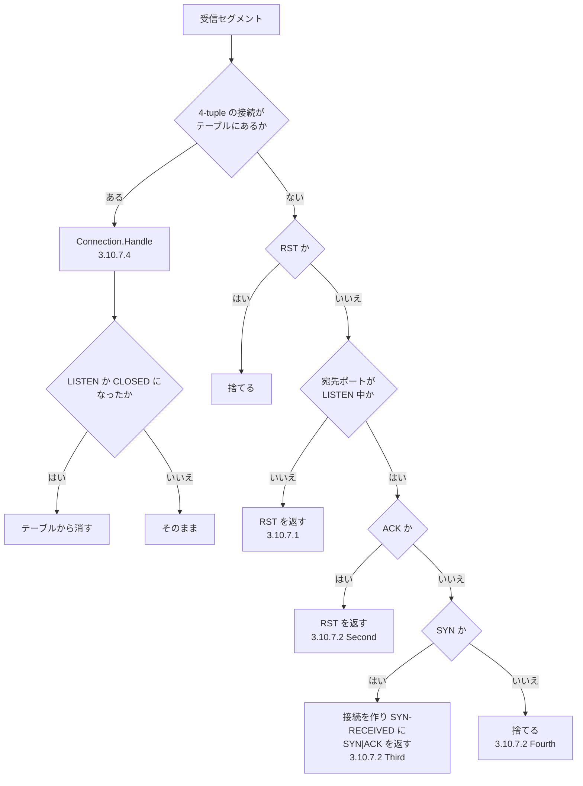
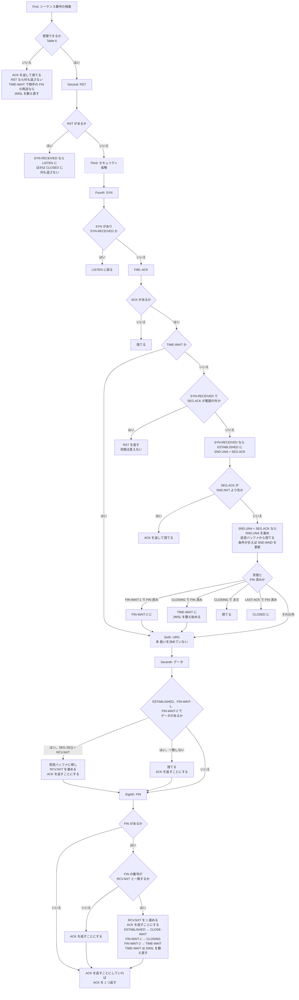
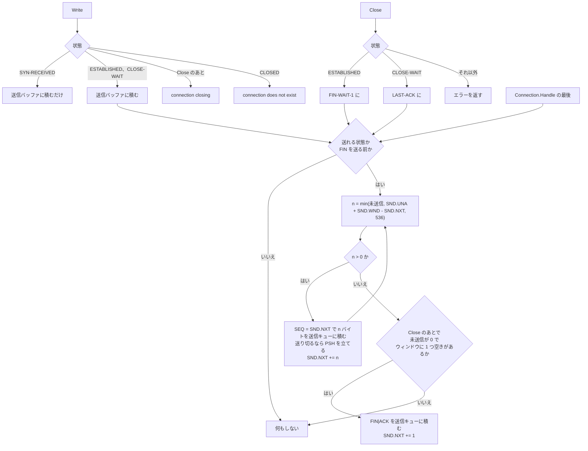
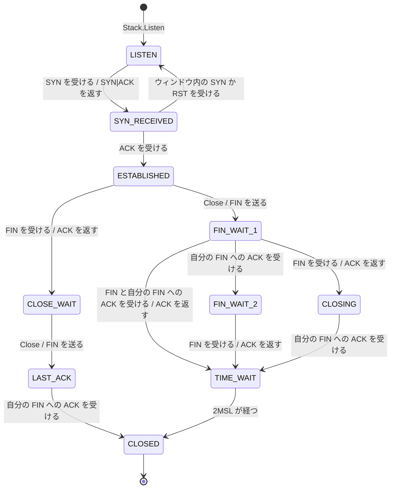

# internal/stack

受信した TCP セグメント、利用者の呼び出し（Write、Close、Abort）、タイマーの満了を受けて、接続の状態を進め、送るセグメントを作る。
全体の中での位置は [docs/design.md](../../docs/design.md) の「機能と実装の対応」の 8〜13 行目に当たる。

このファイルは、中くらいの粒度の説明を置く。「どの状態で、何を受けたら、何をするか」を、仕様の段階とテストに結ぶ。1 つの分岐の理由は、コードのコメントに書いてある。分岐を足したり変えたりしたら、このファイルも直す。

図と表の印: 実線の箱と **済** は実装とテストがある。破線の箱と **未** はこれから実装する。**省略** は仕様にあるが意図してやっていない。

## 振り分け: `Stack.Handle`

セグメントを受けるたびに、`cmd/tuntcp` のループが呼ぶ。接続があれば `Connection.Handle` に渡し、なければここで処理する。



## 接続のあるセグメント: `Connection.Handle`

RFC 9293 3.10.7.4 の 8 つの段階を、上から順に通す。途中で「捨てる」になったら、そこで終わる。
どこで終わっても、最後に `output`（下の「送信」）を通り、送れるようになったデータと FIN を送る。

「FIN 済みか」は、自分の FIN を送り終えていて、SND.UNA が SND.NXT に追いついていること。



FIN の番号は SEG.SEQ + データ長。Seventh でデータを受け取ったあとなら、RCV.NXT と一致する。

## 送信: `Write`、`Close` と `output`

`Write` は送信バッファの後ろに積み、`Close` は状態を移して、どちらも `output` を呼ぶ。`output` は `Connection.Handle` の最後にも呼ばれる。
送るものは `Stack` の送信キューに積み、`main` が `Stack.TakeOutgoing` で取り出して TUN に書く。



送れる状態は、ESTABLISHED、CLOSE-WAIT と、Close のあとで自分の FIN がまだ ACK されていない状態（FIN-WAIT-1、CLOSING、LAST-ACK）。

送信バッファの先頭は SND.UNA に当たる。ACK を受けると先頭から捨てる（Fifth）。FIN は送信バッファに入らない。

```
送信バッファ   |<--- 送信済み、ACK 待ち --->|<---------- 未送信 ---------->| FIN
             SND.UNA                     SND.NXT
                                                  |<- 送ってよい ->|
                                                         SND.UNA + SND.WND
```

`Abort` は、FIN を送り合う前の状態（SYN-RECEIVED、ESTABLISHED、FIN-WAIT-1、FIN-WAIT-2、CLOSE-WAIT）なら `<SEQ=SND.NXT><CTL=RST>` を送り、どの状態でも CLOSED にしてテーブルから消す。

## タイマー: `Stack.HandleTimeouts`

`main` が 1 秒おきに呼ぶ。`Stack.Now` で得た時刻と、接続ごとのタイマーの期限を比べる。いまあるタイマーは TIME-WAIT の 2MSL（4 分）だけ。期限が来たら CLOSED にしてテーブルから消す。何も送らない。

## 状態の遷移

RFC 9293 3.3.2 の Figure 5 のうち、passive open と切断の部分。active open（SYN-SENT）は目標のあと。



図に描いていない遷移: ESTABLISHED から TIME-WAIT までのどの状態でも、ウィンドウ内の RST を受けるか `Abort` を呼ぶと CLOSED になる。FIN-WAIT-1 から TIME-WAIT への遷移は、コードでは同じセグメントの中で FIN-WAIT-2 を経る（Fifth で FIN-WAIT-2、Eighth で TIME-WAIT）。

LISTEN は接続ごとの状態としては持たない。LISTEN 中のポートは `Stack.listeners` が持ち、接続は SYN-RECEIVED になるときに作る。「LISTEN に戻る」と「CLOSED にする」は、どちらも接続をテーブルから消すことを指す。

自分から先に閉じた側だけが TIME-WAIT を通る。あとから閉じた側（CLOSE-WAIT → LAST-ACK）は、自分の FIN への ACK を受けたらすぐ消える。

## 対応表

### 接続がないとき（`Stack.Handle`）

| 条件 | 受けたもの | すること | 仕様 | テスト | 状態 |
|---|---|---|---|---|---|
| どのポートでも | RST | 捨てる | 3.10.7.1、3.10.7.2 First | `TestBuildRST_IgnoresRST`、`TestHandle_Listen` | 済 |
| ポートが閉じている | ACK なし | `<SEQ=0><ACK=SEG.SEQ+SEG.LEN><CTL=RST,ACK>` を返す | 3.10.7.1 | `TestHandle_ClosedPort`、`TestBuildRST` | 済 |
| ポートが閉じている | ACK あり | `<SEQ=SEG.ACK><CTL=RST>` を返す | 3.10.7.1 | `TestHandle_ClosedPort`、`TestBuildRST` | 済 |
| LISTEN 中 | ACK あり | `<SEQ=SEG.ACK><CTL=RST>` を返す | 3.10.7.2 Second | `TestHandle_Listen` | 済 |
| LISTEN 中 | SYN | TCB を初期化して SYN-RECEIVED にし、`<SEQ=ISS><ACK=RCV.NXT><CTL=SYN,ACK>` を返す | 3.10.7.2 Third | `TestHandle_Listen_SYN_InitializesTCB`、`TestHandle_Listen_SYNACK_AdvertisesWindow`、`task e2e` | 済 |
| LISTEN 中 | SYN（セキュリティの検査） | — | 3.10.7.2 Third | — | 省略 |
| LISTEN 中 | それ以外 | 捨てる | 3.10.7.2 Fourth | `TestHandle_Listen` | 済 |

### 接続があるとき（`Connection.Handle`）

「同期済み」は ESTABLISHED から TIME-WAIT までの 7 つの状態。「FIN 受信後」は CLOSE-WAIT、CLOSING、LAST-ACK、TIME-WAIT。

| 段階 | 状態 | 条件 | すること | テスト | 状態 |
|---|---|---|---|---|---|
| First | すべて | Table 6 で受理できない | `<SEQ=SND.NXT><ACK=RCV.NXT><CTL=ACK>` を返して捨てる | `TestSegmentAcceptable`（`internal/tcp`）、`TestHandle_SynReceived_OldSeq_ReACKed`、`TestHandle_SynReceived_RetransmittedSYN`、`TestHandle_Established_UnexpectedSeq`、`TestHandle_Established_ZeroWindow` | 済 |
| First | すべて | 受理できず、RST が立っている | 何も返さずに捨てる | `TestHandle_Established_RSTOutOfWindow_Ignored` | 済 |
| First | FIN 受信後 | 相手の FIN の再送（受理できない） | 上と同じ ACK を返す。状態は変えない | `TestHandle_CloseWait_RetransmittedFIN_ReACKed`、`TestHandle_AfterPeerFIN_RetransmittedFIN_ReACKed` | 済 |
| First | TIME-WAIT | 相手の FIN の再送（FIN の番号が RCV.NXT-1） | ACK を返すのに加えて、2MSL を数え直す | `TestTimeWait_RetransmittedFIN_RestartsTimer`、`TestTimeWait_OtherSegments_DoNotRestartTimer` | 済（[design.md](../../docs/design.md) の「対話で決めた仕様」） |
| First | すべて | RCV.WND が 0 でも、正しい ACK、URG、RST は受け付ける | — | — | 未（M10 で決める） |
| First | すべて | 受理したセグメントの、ウィンドウの外の部分を切り落とす | — | — | 省略（[design.md](../../docs/design.md) の「対話で決めた仕様」） |
| Second | SYN-RECEIVED | RST | LISTEN に戻る。何も返さない | `TestHandle_SynReceived_RST_ReturnsToListen`、`TestHandle_MultipleConnections` | 済 |
| Second | 同期済み | RST | CLOSED にする。何も返さない | `TestHandle_Established_RST_Closes`、`TestHandle_CloseWait_RST_Closes`、`TestHandle_RST_ClosesFromClosingStates` | 済。利用者への通知は未（T8-5） |
| Second | すべて | SEG.SEQ が RCV.NXT と一致しない RST には challenge ACK を返す（RFC 5961） | — | — | 省略（目標のあと） |
| Third | すべて | セキュリティ | — | — | 省略 |
| Fourth | SYN-RECEIVED | SYN | LISTEN に戻る | `TestHandle_SynReceived_NewSYNInWindow_ReturnsToListen` | 済 |
| Fourth | 同期済み | SYN | SYN ビットを無視して先へ進む | — | 未（目標のあと。RFC 5961 の challenge ACK。TIME-WAIT で新しい SYN を受け付けること（MAY-2）もやらない） |
| Fifth | すべて | ACK がない | 捨てる | `TestHandle_SynReceived_NoACK_Dropped` | 済 |
| Fifth | SYN-RECEIVED | `SND.UNA < SEG.ACK =< SND.NXT` | ESTABLISHED にし、SND.WND、SND.WL1、SND.WL2 を設定する | `TestHandle_SynReceived_ACK_Establishes`、`TestHandle_ISSWrapsAround` | 済 |
| Fifth | SYN-RECEIVED | ACK が範囲の外 | `<SEQ=SEG.ACK><CTL=RST>` を返す。状態は変えない | `TestHandle_SynReceived_BadACK`、`TestHandle_SynReceived_BadACK_ISSWrapsAround` | 済 |
| Fifth | 同期済み（TIME-WAIT を除く） | `SND.UNA < SEG.ACK =< SND.NXT` | SND.UNA を進め、ACK された分を送信バッファから捨てる | `TestHandle_Established_ACK`、`TestHandle_Established_ACK_SndUnaWrapsAround`、`TestHandle_Established_ACK_SendsRemainingData`、`TestHandle_CloseWait_ACK_SendsRemainingData` | 済 |
| Fifth | 同上 | `SEG.ACK =< SND.UNA`（重複） | 無視して先へ進む | `TestHandle_Established_ACK`、`TestHandle_FinWait1_ACK` | 済 |
| Fifth | 同上 | `SEG.ACK > SND.NXT`（まだ送っていない） | `<SEQ=SND.NXT><ACK=RCV.NXT><CTL=ACK>` を返して捨てる | `TestHandle_Established_ACK`、`TestHandle_Established_ACKForUnsentData_DropsSegment`、`TestHandle_FinWait1_ACK`、`TestHandle_FinWait2_ACKForUnsentData_DropsSegment` | 済 |
| Fifth | 同上 | `SND.UNA =< SEG.ACK` かつ `(SND.WL1 < SEG.SEQ or (SND.WL1 = SEG.SEQ and SND.WL2 =< SEG.ACK))` | SND.WND、SND.WL1、SND.WL2 を更新する | `TestHandle_Established_WindowUpdate`、`TestHandle_Established_WindowShrinks` | 済 |
| Fifth | FIN-WAIT-1 | 自分の FIN が ACK された | FIN-WAIT-2 にして先へ進む | `TestHandle_FinWait1_ACK`、`TestHandle_FinWait1_DataACKedButNotFIN_StaysFinWait1`、`TestClose_UnsentData_FINWaitsUntilDataIsSent`、`TestClose_FIN_SndNxtWrapsAround` | 済 |
| Fifth | CLOSING | 自分の FIN が ACK された | TIME-WAIT にし、2MSL を数え始める | `TestHandle_Closing_ACK`、`TestHandle_Closing_UnsentData_SentBeforeFIN`、`TestTimeWait_ExpiresAfter2MSL` | 済 |
| Fifth | CLOSING | 自分の FIN がまだ ACK されていない | セグメントを捨てる | `TestHandle_Closing_ACK` | 済 |
| Fifth | LAST-ACK | 自分の FIN が ACK された | CLOSED にする | `TestHandle_LastAck_ACK`、`TestClose_CloseWait_UnsentData_FINWaitsUntilDataIsSent` | 済 |
| Fifth | TIME-WAIT | ACK | 何もしない。ACK も返さない | `TestHandle_TimeWait_PureACK_NoReply` | 済 |
| Fifth | 同期済み | 再送キューから ACK されたものを取り除く | — | — | 未（M9） |
| Sixth | すべて | URG | — | — | 未（扱いを決めていない） |
| Seventh | ESTABLISHED、FIN-WAIT-1、FIN-WAIT-2 | データがあり、SEG.SEQ が RCV.NXT と一致する | データを受信バッファに移し、RCV.NXT を SEG.LEN だけ進め、`<SEQ=SND.NXT><ACK=RCV.NXT><CTL=ACK>` を返す | `TestHandle_Established_Data`、`TestHandle_ClientSeqWrapsAround`、`TestRead_*`、`TestHandle_FinWait_Data_Received`、`task e2e` | 済 |
| Seventh | 同上 | データがあり、SEG.SEQ が RCV.NXT と一致しない | RCV.NXT は進めず、同じ形の ACK を返して捨てる。受信バッファにも入れない | `TestHandle_Established_UnexpectedSeq`、`TestRead_DiscardedDataNotDelivered` | 済（[design.md](../../docs/design.md) の「対話で決めた仕様」） |
| Seventh | 同上 | データがない | 何も返さない | `TestHandle_Established_PureACK_NoReply` | 済 |
| Seventh | FIN 受信後 | データがある | 無視する。受け取らず、返信もしない | `TestHandle_CloseWait_DataIgnored`、`TestHandle_AfterPeerFIN_DataIgnored` | 済 |
| Eighth | 同期済み | FIN があり、FIN の番号（SEG.SEQ + データ長）が RCV.NXT と一致する | RCV.NXT を 1 進め、データの分とまとめて 1 つの ACK を返す | `TestHandle_Established_FIN_EntersCloseWait`、`TestHandle_Established_DataAndFIN_OneACK`、`TestHandle_Established_DuplicateDataWithFIN_FINProcessed`、`TestHandle_Established_FIN_SeqWrapsAround`、`task e2e` | 済。利用者への通知は未（T8-5） |
| Eighth | 同期済み | FIN があり、FIN の番号が RCV.NXT と一致しない | FIN を処理せず、いまの RCV.NXT を ACK で返す | `TestHandle_Established_FINNotAtRcvNxt_NotProcessed` | 済（[design.md](../../docs/design.md) の「対話で決めた仕様」） |
| Eighth | ESTABLISHED（SYN-RECEIVED から Fifth を経た場合を含む） | 上の FIN の処理のあと | CLOSE-WAIT にする | `TestHandle_Established_FIN_EntersCloseWait`、`TestHandle_SynReceived_ACKAndFIN_EntersCloseWait` | 済 |
| Eighth | FIN-WAIT-1 | 同上（自分の FIN はまだ ACK されていない） | CLOSING にする | `TestHandle_FinWait1_FIN_EntersClosing` | 済 |
| Eighth | FIN-WAIT-2（FIN-WAIT-1 から Fifth を経た場合を含む） | 同上 | TIME-WAIT にし、2MSL を数え始める | `TestHandle_FinWait2_FIN_EntersTimeWait`、`TestHandle_FinWait2_DataAndFIN_OneACK`、`TestHandle_FinWait1_FINWithACKOfOurFIN_EntersTimeWait`、`TestTimeWait_ExpiresAfter2MSL` | 済 |
| Eighth | CLOSE-WAIT、CLOSING、LAST-ACK | 同上（相手の誤りでしか起きない） | 状態は変えない | `TestHandle_CloseWait_SecondFINAtRcvNxt_ACKed` | 済。CLOSING と LAST-ACK はテストなし |
| Eighth | TIME-WAIT | 同上（相手の誤りでしか起きない） | 状態は変えず、2MSL を数え直す | `TestTimeWait_FINAtRcvNxt_RestartsTimer` | 済 |

### 送信（`Connection.Write`、`Close`、`Abort`、`output`）

| 状態 | 条件 | すること | 仕様 | テスト | 状態 |
|---|---|---|---|---|---|
| SYN-RECEIVED | `Write` | 送信バッファに積むだけ。ESTABLISHED になったら送る | 3.10.2 | `TestWrite_SynReceived_QueuedUntilEstablished` | 済 |
| ESTABLISHED、CLOSE-WAIT | `Write` か受信のあと | 未送信のデータを、ウィンドウと MSS 536 に収まる分ずつ送る | 3.10.2、3.7.1 MUST-15 | `TestWrite_Established_SendsSegment`、`TestWrite_SegmentsByMSS`、`TestWrite_LimitedBySendWindow`、`TestWrite_SndNxtWrapsAround`、`TestWrite_CloseWait_SendsData` | 済 |
| 同上 | 送り切るセグメント | PSH を立てる | 3.9.1.2 MUST-61 | `TestWrite_SegmentsByMSS`、`TestWrite_LimitedBySendWindow` | 済 |
| 同上 | ウィンドウを使い切った、0、縮んだ | 送らない | 3.3.1 の図 | `TestWrite_WindowFull_SendsNothing`、`TestWrite_ZeroWindow_SendsNothing`、`TestHandle_Established_WindowShrinks` | 済。ゼロウィンドウ probe は未（T10-2） |
| FIN-WAIT-1、FIN-WAIT-2、CLOSING、LAST-ACK、TIME-WAIT | `Write` | "connection closing" を返す | 3.10.2 | `TestWrite_AfterClose_ReturnsError` | 済 |
| CLOSED | `Write` | "connection does not exist" を返す | 3.10.2 | `TestWrite_Closed_ReturnsError` | 済 |
| ESTABLISHED | `Close` | FIN-WAIT-1 にする。データを送り切ったら `<SEQ=SND.NXT><ACK=RCV.NXT><CTL=FIN,ACK>` を送る | 3.10.4 | `TestClose_Established_SendsFIN_EntersFinWait1`、`TestClose_AfterWrite_FINFollowsData`、`TestClose_UnsentData_FINWaitsUntilDataIsSent`、`task e2e` | 済 |
| CLOSE-WAIT | `Close` | LAST-ACK にする。FIN は同じ | 3.10.4 | `TestClose_CloseWait_SendsFIN_EntersLastAck`、`TestClose_CloseWait_UnsentData_FINWaitsUntilDataIsSent`、`task e2e` | 済（FIN を送る前に LAST-ACK に入る点は [design.md](../../docs/design.md)） |
| FIN-WAIT-1、CLOSING、LAST-ACK | FIN を送る前で、未送信が 0 | 相手のウィンドウに 1 つ空きがあれば FIN を送る。なければ待つ | 3.10.4、[design.md](../../docs/design.md) | `TestClose_FINNeedsSendWindow`、`TestHandle_Closing_UnsentData_SentBeforeFIN` | 済 |
| FIN-WAIT-1、FIN-WAIT-2、CLOSING、LAST-ACK、TIME-WAIT | `Close` | "connection closing" を返す。FIN は 2 回送らない | 3.10.4 | `TestClose_AlreadyClosing_ReturnsError`、`TestHandle_FinWait1_ACK` | 済 |
| SYN-RECEIVED | `Close` | エラーを返し、何も変えない | 3.10.4 | `TestClose_AlreadyClosing_ReturnsError` | 省略（[design.md](../../docs/design.md)） |
| SYN-RECEIVED、ESTABLISHED、FIN-WAIT-1、FIN-WAIT-2、CLOSE-WAIT | `Abort` | `<SEQ=SND.NXT><CTL=RST>` を送り、CLOSED にする。未送信のデータは送らない | 3.10.5 | `TestAbort_SendsRST`、`TestAbort_UnsentData_OnlyRST` | 済。実機では確かめていない |
| CLOSING、LAST-ACK、TIME-WAIT | `Abort` | 何も送らずに CLOSED にする | 3.10.5 | `TestAbort_AfterBothFINs_NoRST` | 済 |
| CLOSED | `Close`、`Abort` | "connection does not exist" を返す | 3.10.4、3.10.5 | `TestClose_AlreadyClosing_ReturnsError`、`TestAbort_Closed_ReturnsError` | 済 |

### タイマー（`Stack.HandleTimeouts`）

| 状態 | 条件 | すること | 仕様 | テスト | 状態 |
|---|---|---|---|---|---|
| TIME-WAIT | 入ってから（数え直したなら、そこから）2MSL が経った | CLOSED にしてテーブルから消す。何も送らない | 3.6.1 MUST-13、3.10.8 | `TestTimeWait_ExpiresAfter2MSL`、`TestTimeWait_AfterExpiry_NewSYNAccepted` | 済 |
| それ以外 | どれだけ経っても | 何もしない | — | `TestHandleTimeouts_OutsideTimeWait_NothingHappens` | 済 |
| すべて | 再送タイムアウト | — | 3.10.8 | — | 未（M9） |
| すべて | ユーザータイムアウト | — | 3.10.8 | — | 未（扱いを決めていない） |
