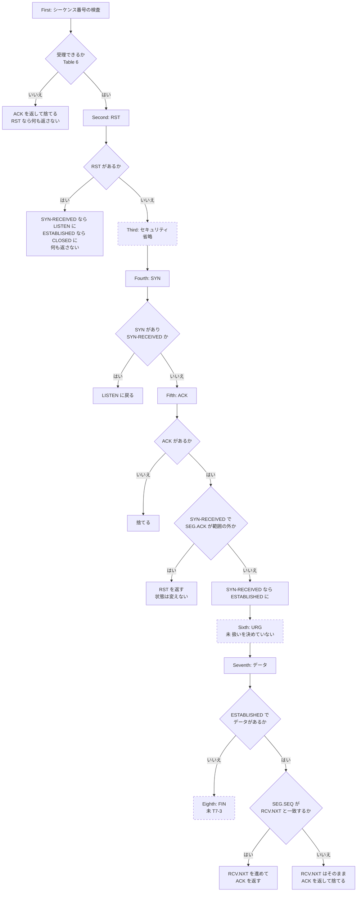
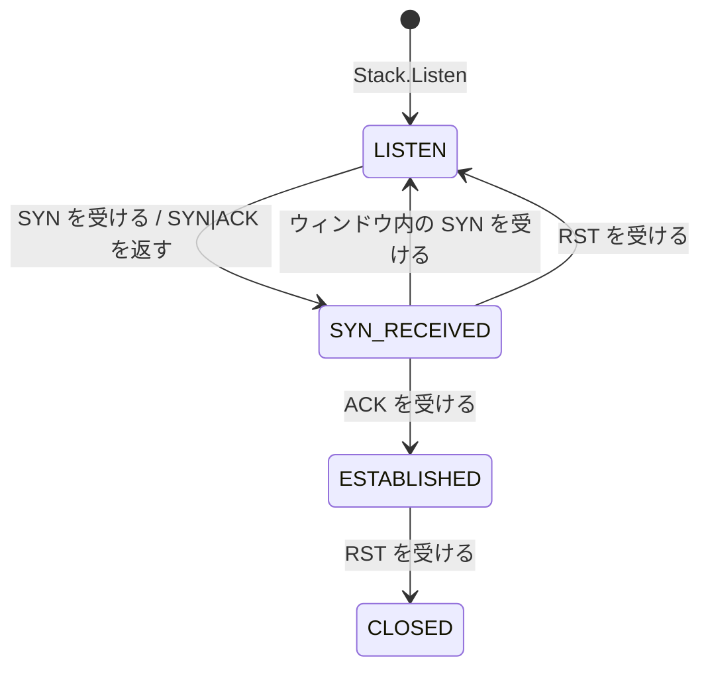

# internal/stack

受信した TCP セグメントを接続に振り分け、状態を進め、返信を作る。
全体の中での位置は [docs/design.md](../../docs/design.md) の「機能と実装の対応」の 8〜13 行目に当たる。

このファイルは、中くらいの粒度の説明を置く。「どの状態で、何を受けたら、何をするか」を、仕様の段階とテストに結ぶ。1 つの分岐の理由は、コードのコメントに書いてある。分岐を足したり変えたりしたら、このファイルも直す。

図と表の印: 実線の箱と **済** は実装とテストがある。破線の箱と **未** はこれから実装する。**省略** は仕様にあるが意図してやっていない。

## 振り分け: `Stack.Handle`

セグメントを受けるたびに、`cmd/tuntcp` のループが呼ぶ。接続があれば `Connection.Handle` に渡し、なければここで処理する。

## 接続のあるセグメント: `Connection.Handle`

RFC 9293 3.10.7.4 の 8 つの段階を、上から順に通す。途中で「捨てる」になったら、そこで終わる。

## 状態の遷移

いま実装してある遷移だけを描く。RFC 9293 3.3.2 の図のうち、passive open の部分に当たる。

LISTEN は接続ごとの状態としては持たない。LISTEN 中のポートは `Stack.listeners` が持ち、接続は SYN-RECEIVED になるときに作る。「LISTEN に戻る」と「CLOSED にする」は、どちらも接続をテーブルから消すことを指す。

## 対応表

### 接続がないとき（`Stack.Handle`）

| 条件 | 受けたもの | すること | 仕様 | テスト | 状態 |
|---|---|---|---|---|---|
| どのポートでも | RST | 捨てる | 3.10.7.1、3.10.7.2 First | `TestBuildRST_IgnoresRST`、`TestHandle_Listen` | 済 |
| ポートが閉じている | ACK なし | `<SEQ=0><ACK=SEG.SEQ+SEG.LEN><CTL=RST,ACK>` を返す | 3.10.7.1 | `TestHandle_ClosedPort`、`TestBuildRST` | 済 |
| ポートが閉じている | ACK あり | `<SEQ=SEG.ACK><CTL=RST>` を返す | 3.10.7.1 | `TestHandle_ClosedPort`、`TestBuildRST` | 済 |
| LISTEN 中 | ACK あり | `<SEQ=SEG.ACK><CTL=RST>` を返す | 3.10.7.2 Second | `TestHandle_Listen` | 済 |
| LISTEN 中 | SYN | TCB を初期化して SYN-RECEIVED にし、`<SEQ=ISS><ACK=RCV.NXT><CTL=SYN,ACK>` を返す | 3.10.7.2 Third | `TestHandle_Listen_SYN_InitializesTCB`、`TestHandle_Listen_SYNACK_AdvertisesWindow`、`task e2e` | 済 |
| LISTEN 中 | SYN（セキュリティの検査） | — | 3.10.7.2 Third | — | 省略 |
| LISTEN 中 | それ以外 | 捨てる | 3.10.7.2 Fourth | `TestHandle_Listen` | 済 |

### 接続があるとき（`Connection.Handle`）

| 段階 | 状態 | 条件 | すること | テスト | 状態 |
|---|---|---|---|---|---|
| First | すべて | Table 6 で受理できない | `<SEQ=SND.NXT><ACK=RCV.NXT><CTL=ACK>` を返して捨てる | `TestSegmentAcceptable`（`internal/tcp`）、`TestHandle_SynReceived_OldSeq_ReACKed`、`TestHandle_SynReceived_RetransmittedSYN`、`TestHandle_Established_UnexpectedSeq`、`TestHandle_Established_ZeroWindow` | 済 |
| First | すべて | 受理できず、RST が立っている | 何も返さずに捨てる | `TestHandle_Established_RSTOutOfWindow_Ignored` | 済 |
| First | すべて | RCV.WND が 0 でも、正しい ACK、URG、RST は受け付ける | — | — | 未（M10 で決める） |
| First | すべて | 受理したセグメントの、ウィンドウの外の部分を切り落とす | — | — | 省略（[design.md](../../docs/design.md) の「対話で決めた仕様」） |
| Second | SYN-RECEIVED | RST | LISTEN に戻る。何も返さない | `TestHandle_SynReceived_RST_ReturnsToListen`、`TestHandle_MultipleConnections` | 済 |
| Second | ESTABLISHED | RST | CLOSED にする。何も返さない | `TestHandle_Established_RST_Closes` | 済 |
| Second | すべて | SEG.SEQ が RCV.NXT と一致しない RST には challenge ACK を返す（RFC 5961） | — | — | 省略（目標のあと） |
| Third | すべて | セキュリティ | — | — | 省略 |
| Fourth | SYN-RECEIVED | SYN | LISTEN に戻る | `TestHandle_SynReceived_NewSYNInWindow_ReturnsToListen` | 済 |
| Fourth | ESTABLISHED | SYN | — | — | 未（目標のあと。RFC 5961 の challenge ACK） |
| Fifth | すべて | ACK がない | 捨てる | `TestHandle_SynReceived_NoACK_Dropped` | 済 |
| Fifth | SYN-RECEIVED | `SND.UNA < SEG.ACK =< SND.NXT` | ESTABLISHED にし、SND.WND、SND.WL1、SND.WL2 を設定する | `TestHandle_SynReceived_ACK_Establishes`、`TestHandle_ISSWrapsAround` | 済 |
| Fifth | SYN-RECEIVED | ACK が範囲の外 | `<SEQ=SEG.ACK><CTL=RST>` を返す。状態は変えない | `TestHandle_SynReceived_BadACK`、`TestHandle_SynReceived_BadACK_ISSWrapsAround` | 済 |
| Fifth | ESTABLISHED | ACK | — | — | 未（T6-6） |
| Sixth | すべて | URG | — | — | 未（扱いを決めていない） |
| Seventh | ESTABLISHED | データがあり、SEG.SEQ が RCV.NXT と一致する | RCV.NXT を SEG.LEN だけ進め、`<SEQ=SND.NXT><ACK=RCV.NXT><CTL=ACK>` を返す | `TestHandle_Established_Data`、`TestHandle_ClientSeqWrapsAround`、`task e2e` | 済。データの保存は未（T6-2） |
| Seventh | ESTABLISHED | データがあり、SEG.SEQ が RCV.NXT と一致しない | RCV.NXT は進めず、同じ形の ACK を返して捨てる | `TestHandle_Established_UnexpectedSeq` | 済（[design.md](../../docs/design.md) の「対話で決めた仕様」） |
| Seventh | ESTABLISHED | データがない | 何も返さない | `TestHandle_Established_PureACK_NoReply` | 済 |
| Eighth | すべて | FIN | — | — | 未（T7-3） |
